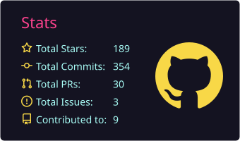
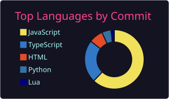

# Hey there, I'm Raul! 👋
  

I build **stupid things** — but like, _on purpose_.  
Welcome to my corner of the internet where I make projects for myself, and occasionally, for the internet to judge (gently, I hope).

## 🧠 Who am I?

I’m just a developer from **Romania** who loves building cool, unnecessary, and sometimes actually useful things.  
Mostly into **frontend** and visual stuff — if it looks nice and does something fun, I probably made it or broke it trying.

---

## 🛠 Greatest Hits

<table>
  <tr>
    <td valign="top" width="50%">
      <h3>📲 <a href="https://github.com/raulpetruta/ha-wa-bridge">HA WhatsApp Bridge</a> </h3>
      A bridge to integrate WhatsApp with Home Assistant for sending messages and run automations based on received messages.  
      <code>Home Assistant</code> | <code>WhatsApp</code> | <code>Puppeteer</code> | <code>Docker</code>
    </td>
    <td valign="top" width="50%">
      <h3>🧺 <a href="https://github.com/raulpetruta/samsung-ha-washer-card">Samsung Washer Card</a> </h3>
      A beautiful, animated Home Assistant card for Samsung washing machines with SmartThings integration.  
      <code>Home Assistant</code> | <code>SmartThings</code> | <code>Lovelace</code> | <code>Samsung Washing Machine</code>
    </td>
  </tr>
</table>

<table>
  <tr>
    <td valign="top" width="50%">
      <h3>🎙️ <a href="https://github.com/raulpetruta/voice-calibration-plugin">Voice Calibration Plugin</a> </h3>
      A voice plugin that teaches AI to write more like you.  
      <code>AI</code> | <code>Voice</code> | <code>Writing</code>
    </td>
    <td valign="top" width="50%">
      <h3>💡 <a href="https://github.com/raulpetruta/ha-govee-ring">Govee Ring</a> </h3>
      Control the ring of a Govee H60A4 ceiling light separately from its main panel in Home Assistant, fully local.  
      <code>Home Assistant</code> | <code>Govee</code> | <code>HACS</code> | <code>LAN</code>
    </td>
  </tr>
</table>

<table>
  <tr>
    <td valign="top" width="50%">
      <h3>🎥 <a href="https://github.com/raulpetruta/obs-cine-zoom">OBS Cine Zoom</a> </h3>
      An OBS Studio Lua script that zooms a display capture and follows your mouse, with smooth spring motion and auto-zoom on clicks, in the spirit of Screen Studio.  
      <code>OBS Studio</code> | <code>Lua</code> | <code>Screen Recording</code> | <code>Zoom</code>
    </td>
    <td width="50%"></td>
  </tr>
</table>

---

## 📊 GitHub Stats (proof I actually code sometimes)

  <picture>
    <source media="(prefers-color-scheme: dark)" srcset="https://raw.githubusercontent.com/raulpetruta/raulpetruta/output/github-snake-dark.svg" />
    
  </picture>

  
  

<i>💛 JavaScript: the language I love to hate and hate to love. But let's be honest, we all know  Claude does all the work.</i>

---

## 🧃 Wanna Be Internet Friends?

Feel free to explore my repos, clone them, break them, fix them (pls), or just drop a ⭐ to fuel my ego.

---

## ☕ Support My Stupidity

If you like what I do and want to help me keep doing it, or just buy me a coffee(I prefer protein shakes tbh), no pressure:

- [Buy Me a Coffee](https://buymeacoffee.com/raulpetruta)
- [PayPal](https://paypal.me/raulpetruta98)

Thanks for fueling my chaotic creative energy 🧃
